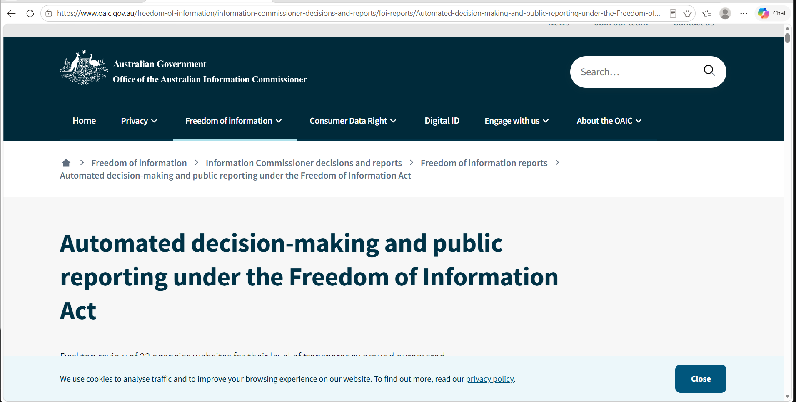
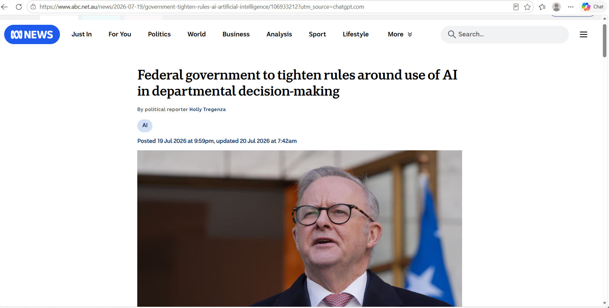
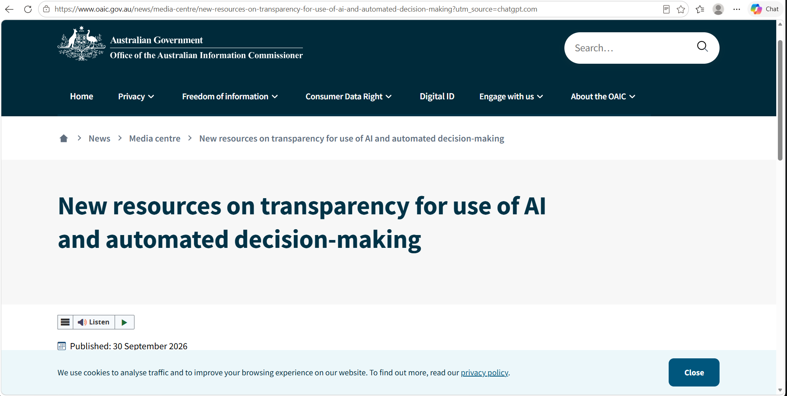
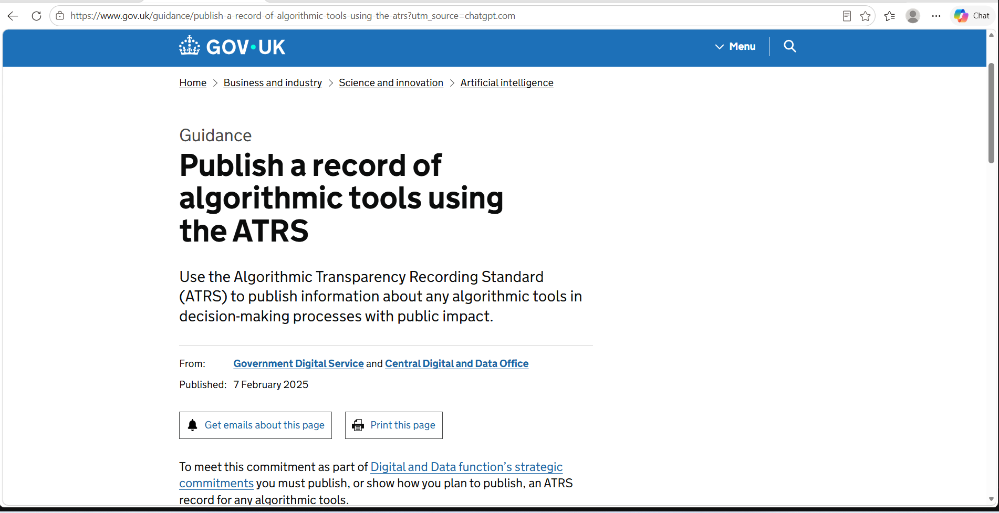
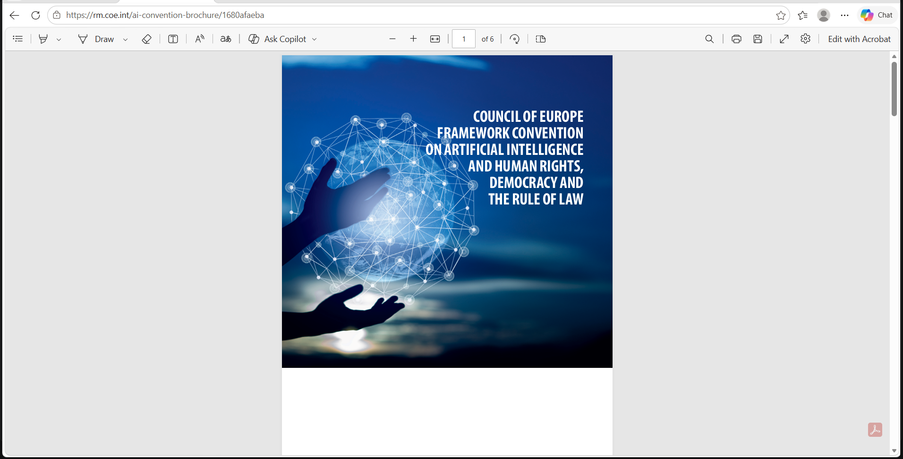
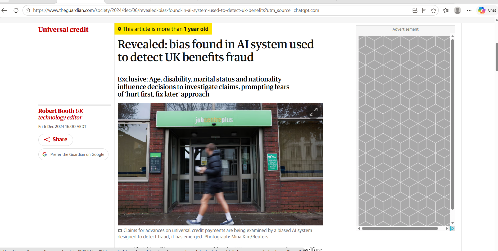

# E-Portfolio 5: Automated Decision Making in Government Systems

**Unit:** COIT11223 - ICT Ethics and Governance in Society  
**Assessment:** Assessment 3 - Question 2  
**Student:** Abdur Rahim  
**Student ID:** 1270056

## Introduction

This e-portfolio examines the use of automated decision making (ADM)
in government systems and its impact on society.

The portfolio focuses on fairness, transparency, privacy,
accountability and the ethical responsibilities of ICT professionals.

It will explore Australian government systems and compare
them with international approaches.

## Learning Artefacts

This portfolio contains six artefacts published from 2024 onwards. They examine government automated decision-making in Australia and overseas, focusing on fairness, privacy, transparency, accountability and professional ethics.

## Artefact 1: Transparency in Australian Government Decision Making

### Artefact

*Figure 1: OAIC (2026), automated decision-making and public reporting. Click the screenshot to open the original report.*

[View the original OAIC report](https://www.oaic.gov.au/freedom-of-information/information-commissioner-decisions-and-reports/foi-reports/Automated-decision-making-and-public-reporting-under-the-Freedom-of-Information-Act)

### Artefact

**Source:** Office of the Australian Information Commissioner (OAIC)  
**Published:** 21 January 2026

[View the official OAIC report](https://www.oaic.gov.au/freedom-of-information/information-commissioner-decisions-and-reports/foi-reports/Automated-decision-making-and-public-reporting-under-the-Freedom-of-Information-Act)

### Summary of the Artefact

The OAIC report examines how Australian Government agencies explain their use of automated decision making to the public. The review looked at 23 agencies authorised to use ADM and found that only four clearly disclosed its use in their Information Publication Scheme information. The report recommends that agencies explain which decisions are automated and publish relevant policies so people can better understand how government decisions are made (OAIC 2026a).

### Justification for Choosing the Artefact

I chose this report because it shows that transparency remains a problem even when government agencies have legal authority to use ADM. The finding that only 17% disclosed their use made me question how people can challenge a decision when they may not know technology was involved. This connects with the ACS principle of public interest, which places responsibility on ICT professionals to consider people affected by their work (Australian Computer Society 2014, p. 6).

### References for Artefact 1

Australian Computer Society 2014, *ACS Code of Professional Conduct*, version 2.1, Australian Computer Society.

Office of the Australian Information Commissioner (OAIC) 2026, *Automated decision-making and public reporting under the Freedom of Information Act*, Australian Government, 21 January, viewed 17 October 2026, https://www.oaic.gov.au/freedom-of-information/information-commissioner-decisions-and-reports/foi-reports/Automated-decision-making-and-public-reporting-under-the-Freedom-of-Information-Act

## Artefact 2: Government AI Decisions and Public Safety

### Artefact

*Federal government to tighten rules around use of AI in departmental decision-making*, ABC News, 19 July 2026.

*Figure 2: ABC News (2026), government oversight of AI. Click the screenshot to open the article.*

[View the original ABC News article](https://www.abc.net.au/news/2026-07-19/government-tighten-rules-ai-artificial-intelligence/106933212)

### Summary of the Artefact

This ABC News article discusses plans to strengthen oversight of artificial intelligence used by Australian Government agencies. The government proposed a framework intended to ensure AI-supported decisions are fair and accurate, alongside stronger privacy protections. The article also describes concerns about automated decisions affecting social services and the need for human involvement in important government processes (Tregenza 2026).

### Justification for Choosing the Artefact

I selected this article because government decisions can directly affect people's income and access to services. It helped me understand why AI should support public servants rather than remove accountability. In my view, people should be able to understand and challenge decisions affecting them. This connects with the ACS Code of Professional Conduct, especially the primacy of the public interest (Australian Computer Society 2014, p. 6).

## Artefact 3: Privacy and Automated Decision Making

### Artefact

*New resources on transparency for use of AI and automated decision-making*, Office of the Australian Information Commissioner, 30 September 2026.

*Figure 3: OAIC (2026), new transparency requirements for automated decisions. Click the screenshot to open the source.*

[View the original OAIC article](https://www.oaic.gov.au/news/media-centre/new-resources-on-transparency-for-use-of-ai-and-automated-decision-making)

### Summary of the Artefact

This OAIC article explains new privacy transparency obligations for organisations and government agencies using automated decision-making systems. From 10 December 2026, entities covered by the Australian Privacy Principles must include information in their privacy policies about certain computer-assisted decisions that significantly affect individuals. This includes describing the types of personal information used and decisions made through automated processes (OAIC 2026b).

### Justification for Choosing the Artefact

I chose this article because privacy is an important issue when governments use personal information to make decisions. People should know when their information is being used by automated systems, especially when the outcome could affect their rights or access to services. I believe clear privacy policies and transparency can help build public trust. This connects with the ACS Code of Professional Conduct, particularly honesty and the primacy of the public interest (Australian Computer Society 2014).

## Artefact 4: UK Government Algorithmic Transparency

### Artefact

*Publish a record of algorithmic tools using the ATRS*, Government Digital Service and Central Digital and Data Office, 7 February 2025.

*Figure 4: Original source evidence. Click the screenshot to open the source.*

[View the original source](https://www.gov.uk/guidance/publish-a-record-of-algorithmic-tools-using-the-atrs)

### Summary of the Artefact

This UK Government guidance explains the Algorithmic Transparency Recording Standard (ATRS). It requires relevant central government organisations to publish, or show plans to publish, information about algorithmic tools that significantly influence decisions with public impact or directly interact with the public. The guidance covers different forms of AI and complex algorithms (Government Digital Service & Central Digital and Data Office 2025).

### Justification for Choosing the Artefact

I chose this guidance because it gives a practical example of how governments can explain their use of algorithms. It also helps me compare the UK's approach with the transparency concerns identified in Australia. Public reporting supports honesty and accountability, which are important under the ACS Code of Professional Conduct (Australian Computer Society 2014).

## Artefact 5: Human Rights and AI in Government

### Artefact

*The Framework Convention on Artificial Intelligence*, Council of Europe, 2024.

*Figure 5: Original source evidence. Click the screenshot to open the source.*

[View the original source](https://www.coe.int/en/web/artificial-intelligence/the-framework-convention-on-artificial-intelligence)

### Summary of the Artefact

The Council of Europe's 2024 Framework Convention on Artificial Intelligence establishes a framework for protecting human rights, democracy and the rule of law in activities involving AI systems. It includes obligations and principles concerning transparency, accountability and risk management, including when public authorities use AI (Council of Europe 2024).

### Justification for Choosing the Artefact

I chose this artefact because automated government decisions can affect people's rights. The convention shows why responsible AI needs more than technical accuracy. Governments should consider possible harm, fairness and accountability before introducing these systems. This relates to the ACS values of public interest and quality of life (Australian Computer Society 2014).

## Artefact 6: Algorithmic Bias in UK Welfare Decisions

### Artefact

Booth, R 2024, *Revealed: bias found in AI system used to detect UK benefits fraud*, The Guardian, 6 December.

*Figure 6: The Guardian (2024), bias in an automated welfare fraud detection system. Click the screenshot to open the article.*

[View the original Guardian article](https://www.theguardian.com/society/2024/dec/06/revealed-bias-found-in-ai-system-used-to-detect-uk-benefits)

### Summary of the Artefact

This Guardian article reports that a UK government AI system used to identify possible Universal Credit fraud showed differences in how it treated people based on age, disability, marital status and nationality. An internal fairness assessment found that the system incorrectly selected some groups more often for investigation. The Department for Work and Pensions said human staff still made the final decisions, but campaigners raised concerns about discrimination and transparency (Booth 2024).

### Justification for Choosing the Artefact

I chose this article because it shows how automated systems can create unfair outcomes even when people review the final decisions. Being wrongly flagged for fraud could cause stress and affect trust in government services. I think developers should test these systems for bias before they are used and regularly check their results. This connects with the ACS Code of Professional Conduct, especially the primacy of the public interest, honesty and competence (Australian Computer Society 2014).

## Personal Reflection

Working on this e-portfolio helped me understand that automated decision-making in government is not only a technical issue. It also involves fairness, privacy, transparency and the rights of people affected by decisions.

The Australian OAIC report made me think about how difficult it can be for people to understand government decisions when agencies do not clearly explain their automated systems. The UK transparency guidance showed me a different approach, where government organisations are expected to publish information about certain algorithmic tools.

The article about bias in the UK welfare system was particularly important to me. It showed that even when a human makes the final decision, the technology used earlier in the process can still create unfair outcomes. I learned that checking algorithms for bias and allowing people to question decisions are important safeguards.

The ACS Code of Professional Conduct helped me connect these examples to professional responsibility. In future ICT work, I would want to consider how a system affects the public, not just whether it works correctly. I now understand why transparency, regular testing and human accountability are important when technology is used in government services.

## AI Use Statement

I used AI tools to help draft and improve my writing, find relevant sources and references, and organise my e-portfolio. I reviewed the information and included screenshots with links to the original sources. I checked the content and references before preparing my final submission.

## References

Australian Computer Society 2014, *ACS Code of Professional Conduct*, version 2.1, Australian Computer Society.

Booth, R 2024, 'Revealed: bias found in AI system used to detect UK benefits fraud', *The Guardian*, 6 December, viewed 17 October 2026, https://www.theguardian.com/society/2024/dec/06/revealed-bias-found-in-ai-system-used-to-detect-uk-benefits

Council of Europe 2024, *The Framework Convention on Artificial Intelligence*, Council of Europe, viewed 17 October 2026, https://www.coe.int/en/web/artificial-intelligence/the-framework-convention-on-artificial-intelligence

Government Digital Service & Central Digital and Data Office 2025, *Publish a record of algorithmic tools using the ATRS*, GOV.UK, 7 February, viewed 17 October 2026, https://www.gov.uk/guidance/publish-a-record-of-algorithmic-tools-using-the-atrs

Office of the Australian Information Commissioner (OAIC) 2026a, *Automated decision-making and public reporting under the Freedom of Information Act*, Australian Government, 21 January, viewed 17 October 2026, https://www.oaic.gov.au/freedom-of-information/information-commissioner-decisions-and-reports/foi-reports/Automated-decision-making-and-public-reporting-under-the-Freedom-of-Information-Act

Office of the Australian Information Commissioner (OAIC) 2026b, 'New resources on transparency for use of AI and automated decision-making', Australian Government, 30 September, viewed 17 October 2026, https://www.oaic.gov.au/news/media-centre/new-resources-on-transparency-for-use-of-ai-and-automated-decision-making

Tregenza, H 2026, 'Federal government to tighten rules around use of AI in departmental decision-making', *ABC News*, 19 July, viewed 17 October 2026, https://www.abc.net.au/news/2026-07-19/government-tighten-rules-ai-artificial-intelligence/106933212
